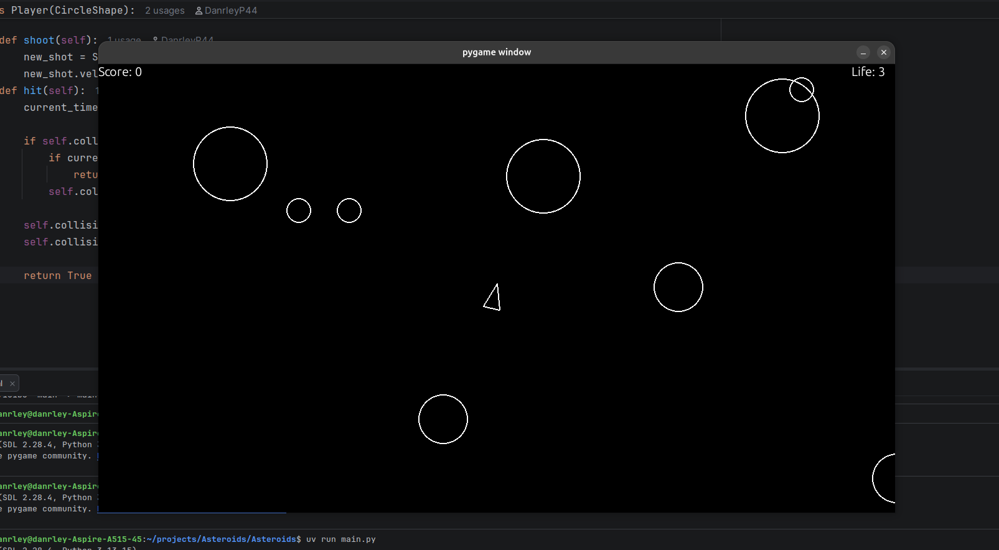
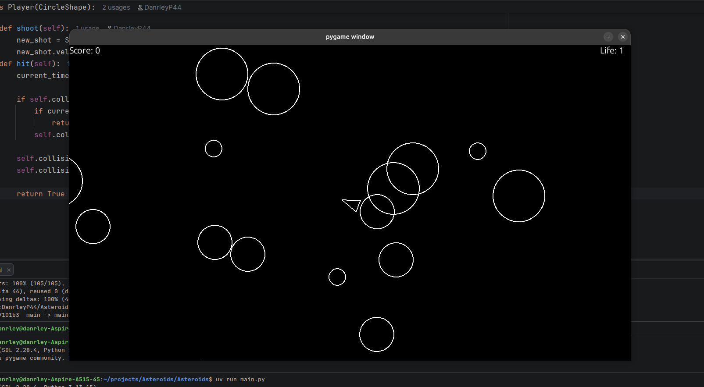

# Asteroids

A small arcade-style Asteroids game built with Python and Pygame. This project was developed as a programming exercise to practice object-oriented programming, sprite management, vector-based movement, collision detection, and coordination of a real-time game loop.

## Demo






## Features

- **Player movement and rotation:** move forward or backward and rotate the ship using the keyboard.
- **Shooting:** fire projectiles with a short cooldown between shots.
- **Asteroid spawning:** asteroids appear at random screen edges at regular intervals, with randomized sizes and movement directions.
- **Asteroid splitting:** shooting a larger asteroid destroys it and creates two smaller asteroids. The smallest asteroids are destroyed when hit.
- **Collision detection:** collisions are checked between the player and asteroids, and between projectiles and asteroids.
- **Score tracking:** destroying asteroids increases the score. The current score is displayed during gameplay.
- **Lives and temporary immunity:** the player starts with three lives and receives a short period of collision immunity after being hit. The game exits when no lives remain.
- **Diagnostic logging:** the game writes JSON Lines (`.jsonl`) files containing sampled game-state data and gameplay events.

## Technologies

- **Python 3.13+:** the language used for the game logic and object-oriented structure. Python 3.13 is the version configured in the project.
- **Pygame 2.6.1:** handles the game window, rendering, keyboard input, timing, vectors, sprites, and sprite groups.
- **uv:** manages the Python project environment and dependencies using `pyproject.toml` and `uv.lock`.

## Programming concepts practiced

- **Object-oriented programming:** `Player`, `Asteroid`, and `Shot` are game objects with their own behavior. They share the `CircleShape` base class where appropriate.
- **Separation of responsibilities:** game entities, configuration constants, asteroid spawning, logging, and the main game loop are separated into different modules.
- **Game loop and frame timing:** the main loop processes events, updates sprites, checks collisions, renders the frame, and limits execution to approximately 60 frames per second. Movement uses the elapsed frame time (`dt`).
- **Vectors and movement:** `pygame.Vector2` represents positions and velocities and supports movement and rotation calculations.
- **Collision detection:** circular distance checks are implemented in `CircleShape.collides_with()` and used by the main loop.
- **Event and keyboard handling:** Pygame events handle window closure, while the player reads keyboard state to move, rotate, and shoot.
- **Sprite groups:** Pygame sprite groups organize objects that need to be updated or drawn.
- **Configuration and diagnostics:** gameplay values are centralized in `constants.py`, while `logger.py` records diagnostic state and events.

## Prerequisites

- **Python 3.13 or later.** The project declares `requires-python = ">=3.13"` and includes a `.python-version` file set to `3.13`.
- **uv**, for dependency and environment management. See the [uv installation guide](https://docs.astral.sh/uv/getting-started/installation/).

The dependency configuration pins **Pygame 2.6.1**.

## Installation and execution

Run these commands from a terminal. The repository contains an outer folder and a nested Python project directory, so enter `Asteroids/Asteroids` before running the project.

### 1. Clone the repository

```bash
git clone https://github.com/DanrleyP44/Asteroids.git
cd Asteroids/Asteroids
```

### 2. Create the environment and install dependencies

```bash
uv sync
```

`uv sync` creates or updates the project's `.venv` environment and installs the dependencies defined by the project files.

### 3. Activate the virtual environment (optional when using `uv run`)

On Linux or macOS:

```bash
source .venv/bin/activate
```

On Windows PowerShell:

```powershell
.venv\Scripts\Activate.ps1
```

### 4. Run the game

The recommended command is:

```bash
uv run main.py
```

If you activated the virtual environment, you can also run:

```bash
python main.py
```

Run the command from the nested `Asteroids/` project directory. The source modules use local imports and are intended to be run from that directory.

## How to play

| Key | Action |
| --- | --- |
| `W` | Move forward |
| `S` | Move backward |
| `A` | Rotate counterclockwise |
| `D` | Rotate clockwise |
| `Space` | Fire a projectile |
| Close the game window | Exit the game |

The ship starts with three lives. Avoid asteroids and shoot them to earn points. Larger asteroids split into smaller ones when hit; the smallest asteroids disappear when destroyed.

## Project structure

```text
.
├── .idea/                       # IDE configuration
├── README.md                    # Repository documentation
├── assets/
│   └── images/
│       └── gameplay.png         # Gameplay screenshot
└── Asteroids/
    ├── .gitignore               # Ignores virtual environment, bytecode, and generated logs
    ├── .python-version          # Configured Python version: 3.13
    ├── README.md                # Empty project-level README referenced by pyproject.toml
    ├── CircleShape.py           # Base sprite class and circular collision check
    ├── asteroid.py              # Asteroid drawing, movement, and splitting
    ├── asteroidfield.py         # Timed asteroid spawning
    ├── constants.py             # Screen dimensions and gameplay values
    ├── logger.py                # JSON Lines diagnostic logging
    ├── main.py                  # Game initialization and main loop
    ├── player.py                # Player controls, movement, shooting, and hit immunity
    ├── pyproject.toml           # Project metadata and dependency declaration
    ├── shot.py                  # Projectile behavior
    └── uv.lock                  # Locked dependency versions
```

The JSONL files `game_state.jsonl` and `game_events.jsonl` are generated at runtime and are ignored by Git.

## What I practiced

Building this project provided hands-on practice with Python classes and inheritance, composing behavior across modules, using Pygame sprite groups, calculating movement with vectors and elapsed frame time, implementing collision checks, and maintaining simple gameplay data such as score and remaining lives. It also provided an opportunity to add diagnostic logging alongside the game mechanics.

## Possible future improvements

- Add a game-over screen and a restart option instead of exiting immediately when all lives are lost.
- Save a high score between sessions.
- Add automated tests for collision detection, asteroid splitting, scoring, and player immunity.
- Remove projectiles that travel off-screen and review object cleanup during longer sessions.

These are ideas for future development, not features currently implemented.

## Author

**Danrley Pereira Bonfim**

- [GitHub profile](https://github.com/DanrleyP44)
- [Asteroids repository](https://github.com/DanrleyP44/Asteroids)
